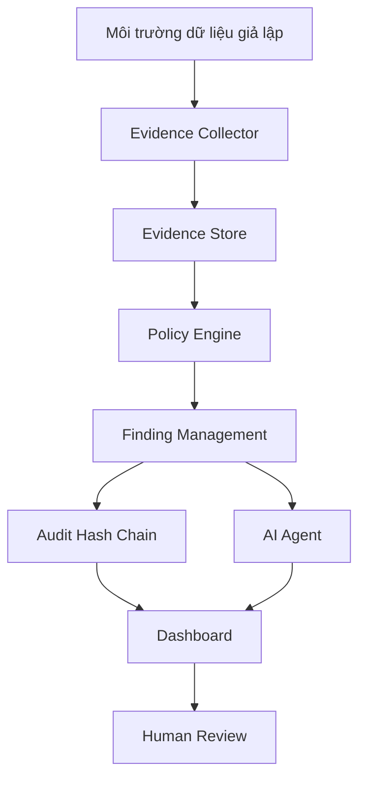

# Kiểm toán tuân thủ liên tục cho nền tảng dữ liệu lớn bằng Policy-as-Code và AI Agent

**Môn học:** Big Data  
**Chủ đề:** 17  
**Nhóm:** 6

---

## 1. Giới thiệu

Dự án xây dựng hệ thống kiểm toán tuân thủ liên tục cho nền tảng dữ liệu lớn bằng cách kết hợp Policy-as-Code, thu thập bằng chứng tự động, xử lý dữ liệu bằng PySpark và AI Agent.

Hệ thống hướng đến việc phát hiện các cấu hình hoặc hoạt động vi phạm chính sách bảo mật, lưu trữ và xử lý dữ liệu. Mỗi phát hiện được liên kết với bằng chứng cụ thể, hỗ trợ kiểm tra tính hợp lệ, truy xuất nguồn gốc và giải thích kết quả kiểm toán.

Thay vì thực hiện kiểm toán thủ công theo từng đợt, hệ thống mô phỏng quy trình kiểm tra liên tục, từ thu thập dữ liệu, đánh giá chính sách đến ghi nhận phát hiện, giải thích và hỗ trợ người kiểm toán đưa ra quyết định.

## 2. Kiến trúc hệ thống

Hệ thống được tổ chức thành pipeline kiểm toán gồm các thành phần liên kết với nhau. Bằng chứng được thu thập và lưu trữ trước khi chuyển sang các bước đánh giá, quản lý phát hiện, giải thích và hiển thị kết quả.



**Luồng hoạt động:**

1. Môi trường giả lập tạo dữ liệu, cấu hình và các tình huống vi phạm.
2. Evidence Collector thu thập thông tin từ các nguồn dữ liệu.
3. Evidence Store lưu trữ bằng chứng phục vụ truy xuất và kiểm tra.
4. Policy Engine thực thi các quy tắc kiểm toán trên evidence.
5. Finding Management ghi nhận và quản lý trạng thái các phát hiện.
6. Audit Hash Chain bảo vệ tính toàn vẹn của nhật ký kiểm toán.
7. AI Agent giải thích vi phạm và đề xuất biện pháp khắc phục dựa trên bằng chứng.
8. Dashboard hiển thị kết quả và hỗ trợ người kiểm toán xem xét, phê duyệt hoặc từ chối đề xuất.

## 3. Các Task thực hiện

Dự án được chia thành 5 Task chính, mỗi Task phụ trách một thành phần kỹ thuật và có đầu ra riêng để tích hợp vào hệ thống tổng thể.

### Task 1 – Xây dựng môi trường giả lập và kịch bản vi phạm

**Mục tiêu:** Xây dựng môi trường Big Data giả lập để tạo dữ liệu, cấu hình và các tình huống tuân thủ/vi phạm phục vụ kiểm thử toàn hệ thống.

**Các công việc:**

- Triển khai môi trường giả lập bằng Docker Compose, bao gồm PostgreSQL, MinIO và môi trường lakehouse sử dụng Delta Lake.
- Cấu hình cơ sở dữ liệu, tài khoản, role, permission, bucket, bảng dữ liệu và các thành phần liên quan.
- Xây dựng kịch bản cấu hình hợp lệ và không hợp lệ thuộc 4 nhóm kiểm soát: Access Control, Retention, Encryption và Data Processing.
- Tạo khoảng 30–50 lỗi cấu hình có chủ đích làm ground truth cho quá trình đánh giá.
- Xây dựng script sinh dữ liệu giả, access log và job log.
- Tạo cơ chế khởi tạo, reset và tái chạy môi trường nhằm đảm bảo các thí nghiệm có thể lặp lại.
- Lưu ground truth riêng, không cho các thành phần kiểm toán truy cập trong quá trình phát hiện.

**Đầu ra:**

- Docker Compose và file cấu hình môi trường.
- Script khởi tạo và reset hệ thống.
- Bộ kịch bản vi phạm và trạng thái hợp lệ.
- Ground truth phục vụ đánh giá.
- Script sinh dữ liệu và log giả.

**Tiêu chí hoàn thành:** Môi trường có thể khởi tạo lại, tạo được các trạng thái tuân thủ và vi phạm, sinh dữ liệu/log phục vụ các Task tiếp theo.

---

### Task 2 – Thu thập và xử lý bằng chứng bằng PySpark

**Mục tiêu:** Xây dựng hệ thống thu thập evidence từ các nguồn giả lập, lưu trữ có khả năng truy xuất và xử lý log quy mô lớn.

**Các công việc:**

- Xây dựng Evidence Collector sử dụng quyền read-only để thu thập dữ liệu từ các thành phần của môi trường giả lập.
- Thu thập thông tin từ PostgreSQL, Delta Lake, IAM, Object Storage và hệ thống log.
- Chuẩn hóa evidence về cấu trúc thống nhất, bao gồm evidence ID, timestamp, nguồn, resource ID, loại bằng chứng, dữ liệu và content hash.
- Xây dựng Evidence Store lưu bằng chứng dưới dạng JSON hoặc Parquet, phân vùng theo nguồn và thời gian, không ghi đè dữ liệu của các lần thu thập trước.
- Tạo manifest cho mỗi lần thu thập để ghi nhận thời gian chạy, trạng thái và số lượng evidence.
- Xây dựng pipeline PySpark để đọc, làm sạch, chuẩn hóa, lọc và tổng hợp log.
- Xử lý bản ghi lỗi, dữ liệu thiếu và dữ liệu không hợp lệ.
- Hỗ trợ truy xuất evidence theo ID, nguồn, tài nguyên và thời gian.
- Kiểm tra khả năng chạy pipeline trên các tập log có quy mô khác nhau.

**Đầu ra:**

- Evidence Collector.
- Schema và Evidence Store.
- Manifest và cơ chế content hash.
- Pipeline xử lý log bằng PySpark.
- Dữ liệu evidence/log mẫu.
- Kết quả kiểm thử thu thập và xử lý dữ liệu.

**Tiêu chí hoàn thành:** Evidence được thu thập và lưu trữ có định danh, truy xuất được nguồn gốc; pipeline PySpark chạy được trên dữ liệu mẫu và tạo ra dữ liệu đầu vào cho Policy Engine.

---

### Task 3 – Xây dựng Policy-as-Code và Policy Engine

**Mục tiêu:** Chuyển các yêu cầu tuân thủ thành các quy tắc có phiên bản, có kiểm thử và có thể thực thi tự động trên evidence.

**Các công việc:**

- Xây dựng danh mục từ 15–25 quy tắc kiểm toán thuộc 4 nhóm Access Control, Retention, Encryption và Data Processing.
- Xác định metadata cho mỗi rule gồm ID, version, title, category, severity, scope, evidence yêu cầu, điều khoản tham chiếu và hướng dẫn khắc phục.
- Định nghĩa các policy bằng YAML và xây dựng hàm kiểm tra bằng Python.
- Xây dựng Policy Engine để tiếp nhận evidence, lựa chọn rule phù hợp và thực thi kiểm tra.
- Hỗ trợ kiểm tra snapshot cấu hình và kiểm tra log bằng PySpark.
- Chuẩn hóa kết quả thành `PASS`, `FAIL`, `ERROR` và `NOT_APPLICABLE`.
- Xây dựng Finding Management để lưu phát hiện, liên kết rule, resource và evidence liên quan.
- Quản lý vòng đời finding với các trạng thái `OPEN`, `RESOLVED` và `REOPENED`.
- Viết unit test bằng pytest, mỗi rule có ít nhất một trường hợp tuân thủ và một trường hợp vi phạm.
- Triển khai tối thiểu 3 quy tắc snapshot bằng OPA/Rego để so sánh với cách triển khai Python.

**Đầu ra:**

- Danh mục policy.
- Các file YAML mô tả rule.
- Mã kiểm tra Python và OPA/Rego.
- Policy Engine.
- Finding Management.
- Bộ unit test và kết quả kiểm thử.

**Tiêu chí hoàn thành:** Policy Engine thực thi được các rule trên evidence, trả về trạng thái chính xác, ghi nhận finding và liên kết từng phát hiện với rule cùng bằng chứng nguồn.

---

### Task 4 – Xây dựng AI Agent giải thích và đề xuất khắc phục

**Mục tiêu:** Xây dựng AI Agent hỗ trợ kiểm toán viên phân tích finding, hiểu nguyên nhân vi phạm và nhận đề xuất khắc phục dựa trên evidence.

**Các công việc:**

- Xác định model, API hoặc framework sử dụng cho AI Agent.
- Cấu hình kết nối AI thông qua biến môi trường, không lưu secrets trong repository.
- Xây dựng prompt định hướng AI theo vai trò trợ lý kiểm toán tuân thủ.
- Xây dựng cơ chế truy xuất context gồm finding, policy, resource metadata và evidence liên quan.
- Cung cấp các công cụ truy xuất dữ liệu ở chế độ read-only.
- Sinh giải thích cho từng finding gồm nội dung vi phạm, nguyên nhân, mức độ ảnh hưởng và đề xuất khắc phục.
- Yêu cầu AI trích dẫn evidence ID làm căn cứ cho nội dung giải thích.
- Chuẩn hóa đầu ra AI theo JSON schema để tích hợp với dashboard.
- Xây dựng Citation Validator kiểm tra evidence ID, sự tồn tại và tính liên quan của citation.
- Xử lý các trường hợp AI trả về thiếu bằng chứng, citation không hợp lệ hoặc sai định dạng.
- Lưu kết quả giải thích và đề xuất để các thành phần khác truy xuất.
- Đánh giá tính chính xác, tính hữu ích của giải thích và so sánh với phương pháp template cố định.

**Đầu ra:**

- AI Agent.
- Prompt và context retrieval.
- Cấu hình model/API.
- Bộ công cụ truy xuất evidence read-only.
- JSON schema đầu ra.
- Citation Validator.
- Bộ dữ liệu kiểm thử và kết quả đánh giá AI.

**Tiêu chí hoàn thành:** AI Agent nhận finding, truy xuất evidence, sinh giải thích và đề xuất theo định dạng chuẩn; citation được kiểm tra bằng mã và agent không có quyền tự động thay đổi hệ thống.

---

### Task 5 – Hash Chain, Dashboard và thực nghiệm đánh giá

**Mục tiêu:** Đảm bảo tính toàn vẹn audit log, xây dựng giao diện theo dõi kiểm toán và đánh giá hiệu quả của toàn bộ hệ thống.

**Các công việc:**

- Thiết kế audit record chứa sự kiện, timestamp, nội dung bản ghi, hash hiện tại và hash của bản ghi trước.
- Xây dựng cơ chế append-only để ghi audit log.
- Liên kết các bản ghi bằng hash nhằm phát hiện thay đổi nội dung hoặc thứ tự.
- Xây dựng chức năng kiểm tra tính toàn vẹn toàn chuỗi.
- Kiểm thử các trường hợp chỉnh sửa, xóa, chèn và đảo thứ tự bản ghi.
- Đo thời gian ghi log và thời gian kiểm tra integrity.
- Xây dựng dashboard hiển thị compliance overview, tỷ lệ tuân thủ, finding, severity, evidence và AI explanations.
- Xây dựng trang chi tiết finding và chức năng review đề xuất AI (approve/reject).
- Ghi lại lịch sử review và quyết định của người kiểm toán.
- Xây dựng script chạy thực nghiệm và lưu kết quả.
- Đối chiếu kết quả phát hiện với ground truth.
- Đo Compliance Coverage, Precision, Recall, False Positive Rate và Detection Latency.
- Đánh giá khả năng mở rộng với log 1M, 10M và 100M dòng bằng PySpark.
- Thử các chu kỳ thu thập 1, 5 và 15 phút để đánh giá thời gian phát hiện.
- Đánh giá citation validity, chất lượng giải thích và tính hữu ích của AI Agent.
- So sánh AI Agent với giải thích bằng template cố định.
- Tổng hợp kết quả thành bảng, biểu đồ và nhận xét phục vụ báo cáo.

**Đầu ra:**

- Audit Hash Chain và công cụ kiểm tra integrity.
- Dashboard kiểm toán.
- Chức năng review và lưu lịch sử quyết định.
- Script chạy thực nghiệm.
- Dữ liệu và log kết quả.
- Bảng/biểu đồ đánh giá.
- Phần kết quả thực nghiệm phục vụ báo cáo.

**Tiêu chí hoàn thành:** Hash Chain phát hiện được các kiểu can thiệp đã thử nghiệm; dashboard hiển thị được kết quả kiểm toán và review; thực nghiệm có số liệu, được lưu trữ và có khả năng tái lập.

---

## 4. Cấu trúc repository

Cấu trúc repository được tổ chức theo các thành phần chức năng và Task để thuận tiện cho phát triển, tích hợp, kiểm thử và bảo trì.

```text
project/
├── docker/                 # Task 1: Môi trường giả lập
├── src/
│   ├── simulator/          # Task 1: Mô phỏng và kịch bản
│   ├── collector/          # Task 2: Thu thập evidence
│   ├── processing/         # Task 2: Pipeline PySpark
│   ├── policy_engine/      # Task 3: Policy engine
│   ├── findings/           # Task 3: Finding management
│   ├── agent/              # Task 4: AI Agent
│   ├── audit/              # Task 5: Hash Chain
│   └── dashboard/           # Task 5: Dashboard
├── policies/               # YAML, Python rules, Rego
├── tests/                   # Unit test và integration test
├── data/                    # Synthetic data và log
├── evidence/                 # Evidence thu thập
├── experiments/              # Script và kết quả thực nghiệm
├── docs/                     # Tài liệu dự án
├── tools/                    # Script hỗ trợ
├── docker-compose.yml
├── requirements.txt
└── README.md
```

<sub>Cấu trúc trên là đề xuất tổ chức mã nguồn theo các Task; tên thư mục sẽ được đồng bộ với implementation thực tế.</sub>

## 5. Công nghệ sử dụng

| Công nghệ | Vai trò |
|---|---|
| Docker / Docker Compose | Triển khai môi trường giả lập |
| Python | Xây dựng logic và các thành phần hệ thống |
| PostgreSQL | Cơ sở dữ liệu và mô phỏng cấu hình |
| MinIO | Mô phỏng object storage |
| Delta Lake | Quản lý dữ liệu lakehouse |
| Apache Spark / PySpark | Xử lý log quy mô lớn |
| OPA / Rego | Định nghĩa và thực thi policy |
| Streamlit | Xây dựng dashboard kiểm toán |
| pytest | Kiểm thử tự động |
| LLM API / SDK | AI Agent giải thích và đề xuất |
| Git | Quản lý phiên bản mã nguồn |

## 6. Cài đặt và triển khai

### 6.1. Yêu cầu môi trường

- Git
- Docker và Docker Compose
- Python 3.10 trở lên
- RAM tối thiểu 8 GB, khuyến nghị 16 GB
- SSD và dung lượng trống phù hợp với quy mô dữ liệu thực nghiệm

### 6.2. Clone repository

```bash
git clone <repository-url>
cd <repository-folder>
```

### 6.3. Cấu hình môi trường

Tạo file cấu hình môi trường từ mẫu:

```bash
cp .env.example .env
```

Cập nhật các biến cần thiết trong `.env`, bao gồm cấu hình dịch vụ và AI API key nếu sử dụng AI Agent.

### 6.4. Khởi chạy hệ thống

```bash
docker compose up -d
```

Kiểm tra trạng thái các dịch vụ:

```bash
docker compose ps
```

### 6.5. Chạy các thành phần hệ thống

Các thành phần collector, policy engine, Spark pipeline và dashboard được chạy theo các entry point tương ứng trong repository.

Dashboard dự kiến truy cập tại:

```text
http://localhost:8501
```

<sub>Các tên file, lệnh chạy và port cần được đồng bộ với cấu hình thực tế của repository trước khi phát hành README.</sub>

## 7. Kiểm thử và đánh giá

Hệ thống được đánh giá trên môi trường giả lập với ground truth đã xác định, tập trung vào độ chính xác phát hiện, hiệu suất và khả năng mở rộng.

| Metric | Mô tả |
|---|---|
| Compliance Coverage | Tỷ lệ các kiểm soát được kiểm tra tự động |
| Precision | Tỷ lệ phát hiện đúng trên tổng số phát hiện |
| Recall | Tỷ lệ vi phạm được phát hiện trên tổng số vi phạm thực tế |
| False Positive Rate | Tỷ lệ trường hợp hợp lệ bị cảnh báo sai |
| Detection Latency | Thời gian từ khi vi phạm xuất hiện đến khi được phát hiện |
| Scalability | Khả năng xử lý dữ liệu khi quy mô log tăng |

Các thử nghiệm chính:

- Kiểm tra rule với các trường hợp tuân thủ và vi phạm.
- Đối chiếu kết quả Policy Engine với ground truth.
- Đo hiệu năng xử lý log ở quy mô 1M, 10M và 100M dòng.
- Đánh giá các chu kỳ thu thập 1, 5 và 15 phút.
- Kiểm tra tính toàn vẹn của Hash Chain khi can thiệp audit log.
- Đánh giá citation validity và chất lượng giải thích của AI Agent.
- So sánh AI Agent với phương pháp giải thích template cố định.

## 8. Phạm vi và giới hạn

### Trong phạm vi

- Môi trường dữ liệu giả lập bằng Docker.
- Kiểm toán 4 nhóm kiểm soát Access Control, Retention, Encryption và Data Processing.
- Thu thập và lưu trữ evidence.
- Policy-as-Code và Policy Engine.
- Xử lý log bằng PySpark.
- AI Agent giải thích và đề xuất khắc phục ở chế độ read-only.
- Hash Chain bảo vệ tính toàn vẹn audit log.
- Dashboard kiểm toán và review.
- Thực nghiệm đo độ chính xác, thời gian phát hiện và khả năng mở rộng.

### Ngoài phạm vi

- Kết nối trực tiếp vào hệ thống production.
- Sử dụng dữ liệu cá nhân thật.
- Tự động thực hiện remediation.
- Thay thế kiểm toán chuyên nghiệp hoặc tư vấn pháp lý.
- Chứng nhận ISO/IEC 27001 hoặc đánh giá toàn bộ hệ thống kiểm soát của tổ chức.
- Triển khai yêu cầu production-grade như High Availability và enterprise multi-tenancy.

## 9. Deliverables

| Mã | Sản phẩm bàn giao | Nội dung |
|---|---|---|
| SP1 | Solution Specification | Bài toán, yêu cầu, kiến trúc, luồng dữ liệu, thuật toán, giao diện và mô hình triển khai |
| SP2 | Prototype System | Hệ thống nguyên mẫu kiểm toán tuân thủ |
| SP3 | README.md | Hướng dẫn cài đặt, cấu hình, triển khai, vận hành và sử dụng |
| SP4 | Báo cáo LaTeX | Báo cáo IEEE tiếng Việt, tối thiểu 20 trang |
| SP5 | Presentation | Slide PPTX cho buổi thuyết trình khoảng 30 phút |
| SP6 | Source Code & Data | Mã nguồn, kịch bản, bộ kiểm thử và dữ liệu thực nghiệm |

## 10. Lưu ý an toàn

- Chỉ sử dụng dữ liệu giả lập trong phạm vi dự án.
- Không kết nối trực tiếp với môi trường production.
- Không commit API key, mật khẩu hoặc secrets vào repository.
- AI Agent chỉ được phép truy xuất và phân tích dữ liệu ở chế độ read-only.
- Citation của AI phải được kiểm tra trước khi hiển thị như căn cứ kiểm toán.
- Mọi đề xuất khắc phục cần được người kiểm toán xem xét trước khi thực hiện.

---

**Nhóm 6 – Big Data | Chủ đề 17**
